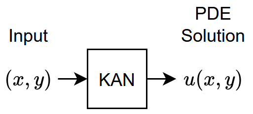
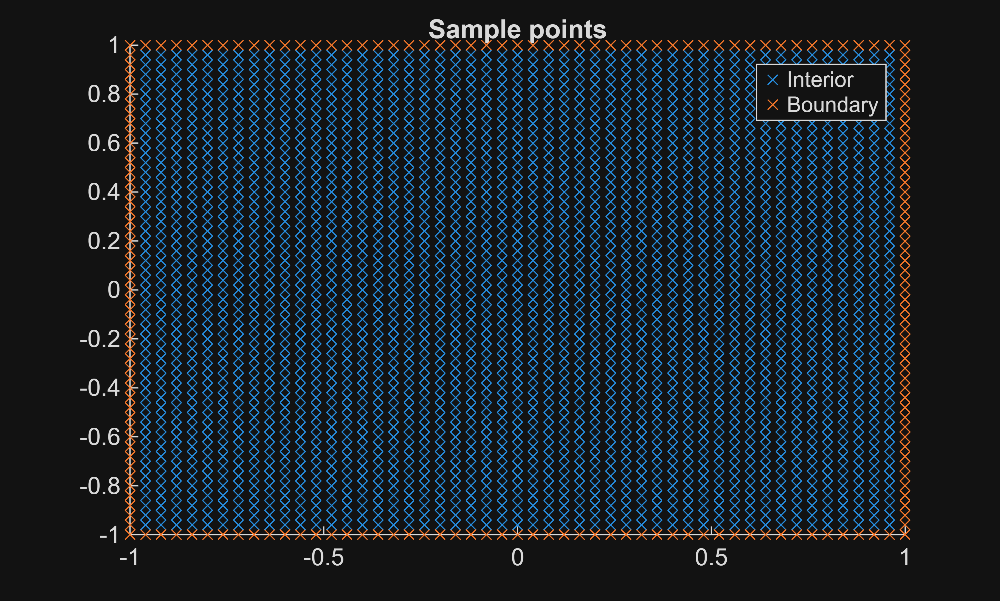
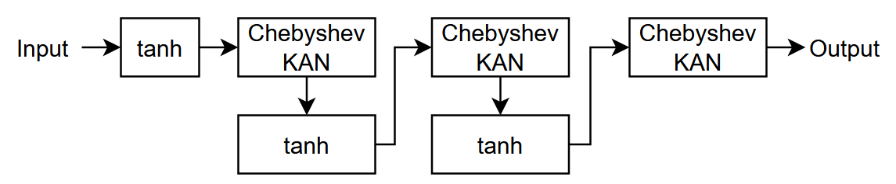
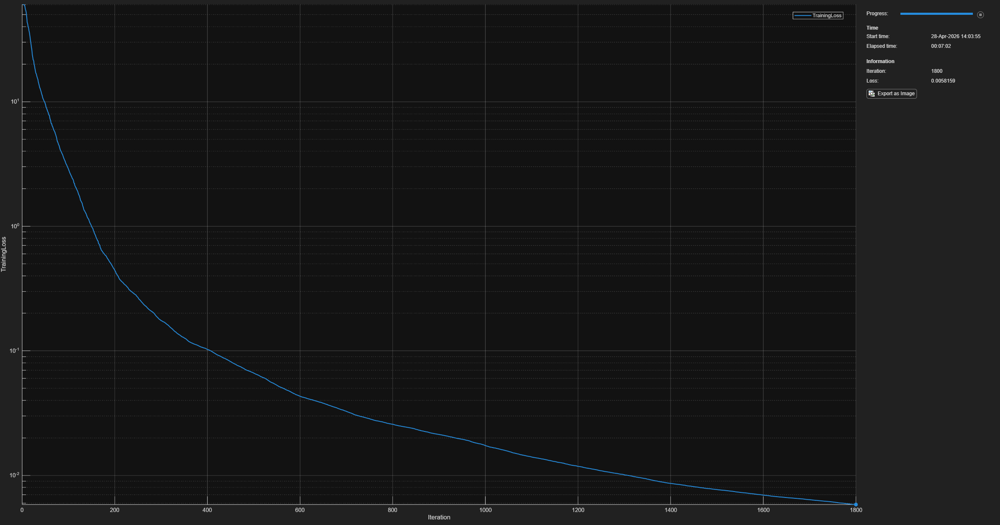
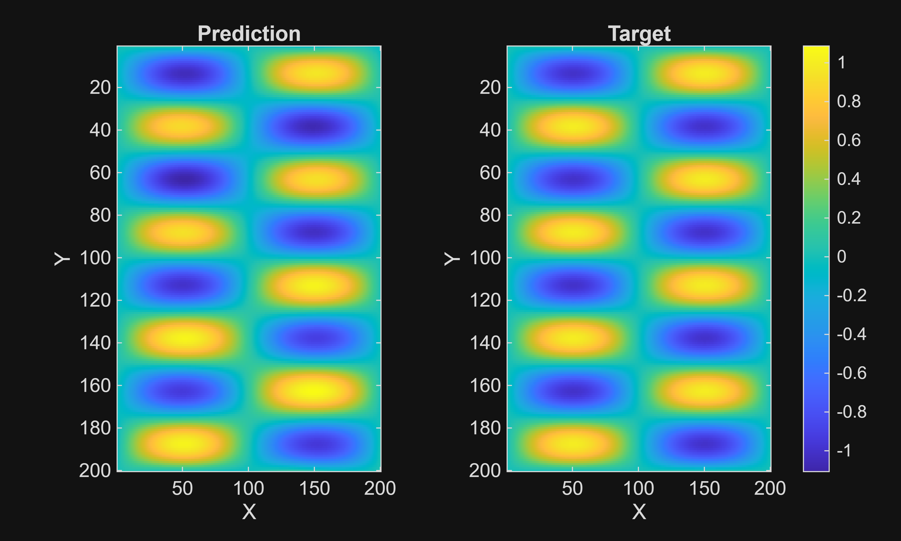
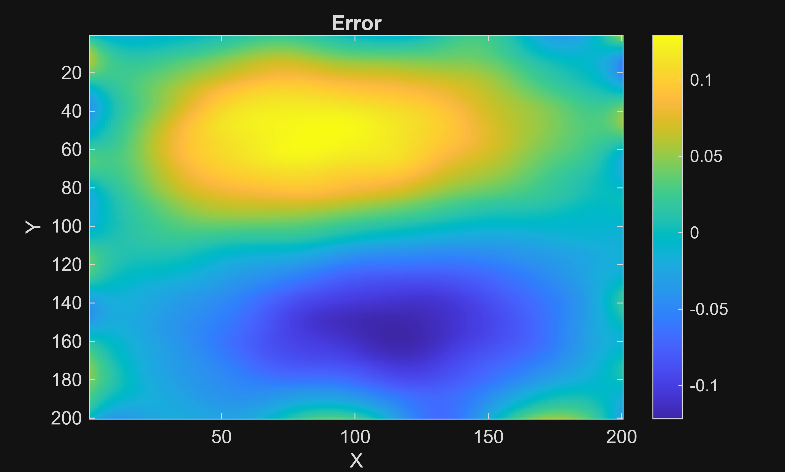
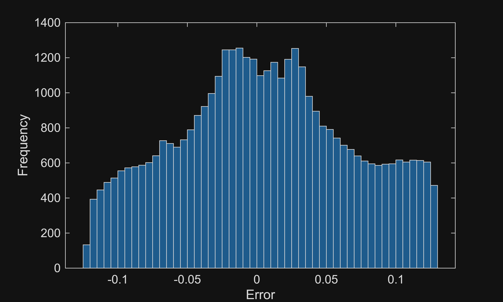

# Solve Helmholtz Equation Using Kolmogorov\-Arnold Network (KAN)

This example shows how to use a Chebyshev\-based Kolmogorov\-Arnold neural network that solves the Helmholtz equation.


A Kolmogorov\-Arnold neural network (KAN) is a type of neural network inspired by the Kolmogorov\-Arnold representation theorem \[[1](#M_050a)\]. It approximates multivariate functions using structured function compositions with fewer parameters. KANs are general\-purpose function approximators. This example uses a KAN to represent a physics\-informed neural network (PINN). A physics\-informed neural network is a neural network that incorporates physical laws into its structure and training process \[[2](#M_050a)\]. For example, you can train a PINN by incorporating the definition of a partial differential equation (PDE) that defines a physical system in the loss function.


This example trains a Chebyshev\-based KAN \[[3](#M_050a)\] that outputs the PDE solution $u(x,y)$ of the Helmholtz equation given the input $(x,y)$.


This diagram shows the flow of the data through the neural network.





The Helmholtz equation is a PDE that describes steady\-state wave phenomena. For example, you can model acoustic pressure patterns at specified frequencies by solving the Helmholtz equation.


The Helmholtz equation is typically written as


 $\Delta u+k^2 u=q$,


where $\Delta$ is the Laplacian, $k$ is the wave number, and $q$ is the forcing term. The equation is an eigenvalue PDE problem, where $k^2$ is the eigenvalue.


In this example, the task is in two\-dimensional space and the forcing term is


 $q(x,y)=\left(k^2 -(a\pi )^2 -(b\pi )^2 \right)\sin (a\pi x)\sin (b\pi y)$.


Training the neural network does not require examples of the solutions $u(x,y)$. It only requires the definition of the PDE, the initial and boundary conditions, and examples of $(x,y)$. With a KAN, you can make predictions at higher resolutions than those used to train the neural network.

# Generate Training Data

The full PDE is specified on the domain $\Omega =[-1,1]\times [-1,1]$, with Dirichlet boundary conditions $u(x,-1)=u(x,1)=u(-1,y)=u(1,y)=0$.


First, sample a set of $51\times 51$ uniformly arranged collocation points in the domain $\Omega$. To ensure that the points are close to, but do not reside on the boundary, use the value of `eps` as an offset. 

```matlab
sz = 51;

X = linspace(-1+eps,1-eps,sz);
Y = linspace(-1+eps,1-eps,sz);
[X,Y] = meshgrid(X,Y);

XYTrain = cat(3,X,Y);
XYTrain = reshape(XYTrain,[],2);
```

Next, sample a set of $51\times 4$ boundary points $Y_j$ on the boundary $\partial \Omega$ of the domain $\Omega$.

```matlab
sz = 51;

X = [
    -1*ones(sz,1)
    linspace(-1,1,sz).'
    ones(sz,1)
    linspace(-1,1,sz).'];

Y = [
    linspace(-1,1,sz).'
    -1*ones(sz,1)
    linspace(-1,1,sz).'
    ones(sz,1)];

XYBoundaryTrain = [X Y];
```

Visualize the generated data in a scatter plot.

```matlab
figure
scatter(XYTrain(:,1),XYTrain(:,2),"x")

hold on
scatter(XYBoundaryTrain(:,1),XYBoundaryTrain(:,2),"x")

legend(["Interior" "Boundary"])
title("Sample points")
```


# Define Chebyshev KAN Layer

The original KAN architecture in \[[1](#M_050a)\] uses B‑splines as the edge basis functions. There are several variants of the KAN architecture. This example uses a Chebyshev‑KAN variant, which was shown to perform well in a recent comparative study \[[4](#M_050a)\].


Define the architecture of the Chebyshev KAN layer. The layer computes the Chebyshev basis of the input and then applies a fully connected operation.


First, define a function that computes the Chebyshev basis. The Chebyshev basis is a set of polynomial functions defined recursively as:


 $T_0 (x)=1$,


 $T_1 (x)=x$,


 $T_{k+1} (x)=2xT_k (x)-T_{k-1} (x)$,


where $k=0,1,\ldots,d$, where $d$ is the degree of the basis. You can express $T_k (x)$ as


 $T_k (x)=\cos (k\cdot \arccos (x))$.


These functions are commonly used for function approximation and form an orthogonal basis on the interval \[−1,1\] with respect to the weighted inner product:


 $\langle f,g\rangle =\int_{-1}^1 \frac{f(x)g(x)}{\sqrt{1-x^2 }}\,dx$.


This inner product is distinct from the standard dot product and reflects the weight function $w(x)=(1-x^2 )^{-1/2}$, which is associated with Chebyshev polynomials.


The `chebyshevBasis` function takes the input data and degree and computes these basis functions. Because this function changes the number of dimensions of the input, to use this function in a `functionLayer` object, the function must support formatted `dlarray` objects as input and return a formatted `dlarray` object. Output data with a format of `"CB"` (channel, batch).

```matlab
function Y = chebyshevBasis(X,degree)

X = stripdims(X);
k = permute(0:degree,[3 1 2]);

Y = cos(k.*acos(X));

Y = permute(Y,[1 3 2]);
Y = reshape(Y,[],size(Y,3));

Y = dlarray(Y,"CB");

end
```

Define the weights initialization function for the fully connected layer. Initialize the weights by independently sampling from a normal distribution with zero mean and a standard deviation $1/N_i$, where $N_i$ is the number of input channels.

```matlab
function weights = initializeChebyshev(sz)

numOut = sz(1);
numIn = sz(2);

weights = randn(numOut,numIn,"single") / numIn;

end
```

Create a function that creates the Chebyshev KAN layer architecture. The `chebyshevKANLayer` takes a hidden size and degree value as input and returns a `networkLayer` object that represents the Chebyshev KAN layer. The layer computes the Chebyshev basis using a function layer and applies the linear combination with a fully connected layer. The fully connected layer initializes the weights using the `initializeChebyshev` function. To ensure that the bias is always zero, the layer has a bias learning rate factor of zero.

```matlab
function layer = chebyshevKANLayer(hiddenSize,degree)

layers = [
    functionLayer(@(X)chebyshevBasis(X,degree),Formattable=true,Acceleratable=true)
    fullyConnectedLayer(hiddenSize,WeightsInitializer=@initializeChebyshev,BiasLearnRateFactor=0)];

layer = networkLayer(layers,Name="cheb_kan");

end
```
# Define Neural Network Architecture

This diagram shows the neural network architecture used in this example. The network consists of three Chebyshev\-KAN layers with tanh layers to keep the inputs within fixed bounds and help stabilize training.





Define the neural network architecture.

-  For the input, use a feature input layer with an input size that matches the dimensionality of the input data. In this example, the input data is two\-dimensional. 
-  For the intermediate Chebyshev KAN layers, specify a hidden size of eight and a degree of five. 
-  For the final Chebyshev KAN layer, specify a hidden size that matches the dimensionality of the output data. In this example, the output data is one\-dimensional. 
```matlab
hiddenSize = 8;
degree = 5;
inputDimension = 2;
outputDimension = 1;

layers = [
    featureInputLayer(inputDimension)
    tanhLayer
    chebyshevKANLayer(hiddenSize,degree)
    tanhLayer
    chebyshevKANLayer(hiddenSize,degree)
    tanhLayer
    chebyshevKANLayer(outputDimension,degree)];
```
# Define Model Loss Function

For a predicted solution $v$, the KAN loss function is


 $\textrm{loss}(v)=w_{\textrm{Boundary}} {\mathcal{L}}_{\textrm{Boundary}} (v)+w_{\textrm{PDE}} {\mathcal{L}}_{\textrm{PDE}} (v)$,


where $w_{\textrm{Boundary}}$ and $w_{\textrm{PDE}}$ are positive weight factors that balance the contributions of the boundary and PDE losses. 


The boundary loss ${\mathcal{L}}_{\textrm{Boundary}} (v)$ is


 ${\mathcal{L}}_{\textrm{Boundary}} (v)={\left\|v|_{\partial \Omega } \right\|}_{L^2 (\partial \Omega )}^2$,


where $v|_{\partial \Omega }$ indicates the restriction of the function $v:\Omega \to \mathbb{R}$ to a function $v:\partial \Omega \to \mathbb{R}$ on the boundary $\partial \Omega$.The boundary loss approaches zero when the predictions $v$ satisfy the PDE on the boundary.


The PDE loss ${\mathcal{L}}_{\textrm{PDE}} (v)$ is     


 ${\mathcal{L}}_{\textrm{PDE}} (v)={\left\|\Delta v+k^2 v-q\right\|}_{L^2 (\Omega )}^2$.


The PDE loss approaches zero when the predictions $v$ satisfy the PDE.


You can approximate these loss values by computing the residuals $r_i =\left|\Delta v(x_i ,y_i )+k^2 v(x_i ,y_i )-q(x_i ,y_i )\right|$ and $R_j =\left|v(x_j ,y_j )\right|$ on the sets of interior and boundary points, respectively.


A common issue with this approach is that $L^2$ norms in the loss can become very small, but the pointwise $L^{\infty }$ error can still be large. To address this, you can use residual\-based attention \[[5](#M_050a)\]. Redefine the PDE loss as


 ${\mathcal{L}}_{\textrm{PDE}} (v)=\frac{1}{N_{\textrm{PDE}} }\sum_i \alpha_i^2 r_i^2$,


where $N_{\textrm{PDE}}$ is the number of interior points and $\alpha$ is a vector of scaling factors. The training loop updates the values of $\alpha$ at each iteration. The loop initializes the values with ones, and for each iteration, the loop updates the values using the update rule


 $\alpha_i \to (1-\eta )\alpha_i +\eta \frac{\left|r_i \right|}{\max_j \left|r_j \right|}$,


where $\eta$ is a hyperparameter that controls the weight of largest residuals $r_i$ from the previous training iterations.


Create the model loss function. The `modelLoss` function takes the KAN, interior and boundary points, and the scaling factors $\alpha$ as input. The function returns the loss, the gradients of the loss with respect to the learnable parameters, and the residuals.


In this example, use the values $k=3$, $a=1$, and $b=4$.

```matlab
function [loss,gradients,absResiduals] = modelLoss(net,XY,XYBoundary,alpha)

% Forward pass data through network. For performance, pass interior and
% boundary points together.
Xs = cat(2,XY,XYBoundary);
Us = predict(net,Xs);

% Split predictions.
U = Us(:,1:size(XY,2));
UBoundary = Us(:,size(XY,2)+1:end);

% Evaluate forcing term.
a = 1;
b = 4;
k = 3;

q = (k^2 - (a*pi)^2 - (b*pi)^2) * sin(a*pi*XY(1,:)) .* sin(b*pi*XY(2,:));

% Evaluate residuals.
U = stripdims(U);
XY = stripdims(XY);
delta = dllaplacian(U,XY,1);
residuals = delta + k^2 * U - q;
absResiduals = abs(residuals);

% Evaluate loss.
wPDE = 0.01;
wBoundary = 1;

lossPDE = mean((residuals.*alpha).^2);
lossBoundary = mean(UBoundary.^2);

loss = wPDE*lossPDE + wBoundary*lossBoundary;

% Evaluate gradients of the loss.
gradients = dlgradient(loss,net.Learnables);

end
```
# Specify Training Options

Specify the training options:

-  Train for a maximum of 1800 iterations. 
-  For the L\-BFGS solver, specify a gradient and step tolerance of $10^{-5}$. 
-  For the residual\-based attention, set the weight factor to $10^{-4}$. 
```matlab
maxIterations = 1800;
gradientTolerance = 1e-5;
stepTolerance = 1e-5;
eta = 1e-4;
```
# Train Neural Network

Train the neural network using a custom training loop.


Train using an L\-BFGS solver. Initialize the solver state.

```matlab
solverState = lbfgsState;
```

Transpose the data and convert it to `dlarray` objects.

```matlab
XYTrain = dlarray(XYTrain,"BC");
XYBoundaryTrain = dlarray(XYBoundaryTrain,"BC");
```

Initialize the values for residual\-based attention.

```matlab
alpha = dlarray(ones(1,size(XYTrain,2)));
```

Accelerate the model loss function.

```matlab
accfun = dlaccelerate(@modelLoss);
```

Initialize the neural network.

```matlab
net = dlnetwork(layers);
```

Monitor the training progress in a plot.

```matlab
monitor = trainingProgressMonitor( ...
    Metrics="TrainingLoss", ...
    Info=["Iteration","Loss"], ...
    XLabel="Iteration");
yscale(monitor, "TrainingLoss", "log");
```

Train the neural network using a custom training loop. For each iteration:

-  Parameterize the loss function using the network, interior and boundary points, and the values of `alpha`. 
-  Update the neural network and solver state using the model loss function. 
-  Extract the residuals from the solver state and update the values of `alpha`. 
-  Update the training progress plot. 

Stop training when the custom training loop reaches the maximum number of iterations or when the L\-BFGS solver completes or fails.

```matlab
iteration = 0;

while iteration < maxIterations && ~monitor.Stop
    iteration = iteration + 1;

    % Update network using loss function.
    lossFcn = @(net) dlfeval(accfun,net,XYTrain,XYBoundaryTrain,alpha);
    [net, solverState] = lbfgsupdate(net,lossFcn,solverState,NumLossFunctionOutputs=3);

    % Evaluate alpha for residual-based attention.
    absRes = solverState.AdditionalLossFunctionOutputs{1};
    alpha = (1-eta).*alpha + eta.*(absRes./max(absRes));

    % Update training progress plot.
    updateInfo(monitor, ...
        Iteration=iteration,...
        Loss=solverState.Loss);
    recordMetrics(monitor,iteration,TrainingLoss=solverState.Loss);
    monitor.Progress = 100*iteration/maxIterations;

    % Check solver state for completion.
    if solverState.GradientsNorm < gradientTolerance || ...
            solverState.StepNorm < stepTolerance || ...
            solverState.LineSearchStatus == "failed"
        break
    end
end
```


# Test Neural Network

If you know the exact form of the PDE solutions or you can compute the solutions numerically, then you can test the neural network by comparing the predictions to the target solutions.


In this example, the setup of the task allows for solutions of the form


 $u(x,y)=\sin ⁡(a\pi x)\sin ⁡(b\pi y)$.


You can make predictions with data with higher resolution than the data that you used for training. Test the neural network with $200\times 200$ uniformly arranged collocation points in the domain and boundary.


Generate the input data.

```matlab
szTest = 200;

XTest = linspace(-1,1,szTest);
YTest = linspace(-1,1,szTest);
[XTest,YTest] = meshgrid(XTest,YTest);

XYTest = cat(3,XTest,YTest);
XYTest = reshape(XYTest,[],2);
```

Make predictions with the neural network.

```matlab
UTest = predict(net,XYTest);
UTest = reshape(UTest,szTest,szTest);
```

Calculate the target solutions using the exact analytical solution.

```matlab
a = 1; 
b = 4;

TTest = sin(a*pi*XYTest(:,1)) .* sin(b*pi*XYTest(:,2));
TTest = reshape(TTest,szTest,szTest);
```

Compare the predictions and targets in an image plot with scaled colors.


To ensure that the color scales are consistent across the plots, compute the minimum and maximum values of the data.

```matlab
m = min([UTest TTest],[],"all");
M = max([UTest TTest],[],"all");
clims = [m M];
```

Create plots of the predicted values and the target values.

```matlab
figure
tiledlayout(1,2)
nexttile
imagesc(UTest,clims)
title("Prediction")
xlabel("X")
ylabel("Y")

nexttile
imagesc(TTest,clims)
title("Target")
xlabel("X")
ylabel("Y")
colorbar
```



Visualize the error between the predicted values and the target values in a plot.

```matlab
difference = TTest - UTest;
figure
imagesc(difference)

title("Error")
xlabel("X")
ylabel("Y")
colorbar
```



Visualize the errors in a histogram.

```matlab
figure
histogram(difference)
xlabel("Error")
ylabel("Frequency")
```


# References
<a id="M_050a"></a>
1.  Liu, Ziming, Yixuan Wang, Sachin Vaidya, Fabian Ruehle, James Halverson, Marin Soljačić, Thomas Y. Hou, and Max Tegmark. 'KAN: Kolmogorov\-Arnold Networks'. arXiv, 9 February 2025. [https://doi.org/10.48550/arXiv.2404.19756](https://doi.org/10.48550/arXiv.2404.19756).
2. Raissi, M., P. Perdikaris, and G. E. Karniadakis. ‘Physics\-Informed Neural Networks: A Deep Learning Framework for Solving Forward and Inverse Problems Involving Nonlinear Partial Differential Equations’. *Journal of Computational Physics* 378 (1 February 2019): 686–707. [https://doi.org/10.1016/j.jcp.2018.10.045](https://doi.org/10.1016/j.jcp.2018.10.045).
3. SS, Sidharth, Keerthana AR, Gokul R, and Anas KP. 'Chebyshev Polynomial\-Based Kolmogorov\-Arnold Networks: An Efficient Architecture for Nonlinear Function Approximation'. arXiv, 14 June 2024. [https://doi.org/10.48550/arXiv.2405.07200.](https://doi.org/10.48550/arXiv.2405.07200.)
4. Shukla, Khemraj, Juan Diego Toscano, Zhicheng Wang, Zongren Zou, and George Em Karniadakis. ‘A Comprehensive and FAIR Comparison between MLP and KAN Representations for Differential Equations and Operator Networks’. arXiv, 5 June 2024. [https://doi.org/10.48550/arXiv.2406.02917](https://doi.org/10.48550/arXiv.2406.02917).
5. Anagnostopoulos, Sokratis J., Juan Diego Toscano, Nikolaos Stergiopulos, and George Em Karniadakis. ‘Residual\-Based Attention and Connection to Information Bottleneck Theory in PINNs’. arXiv, 1 July 2023. [https://doi.org/10.48550/arXiv.2307.00379](https://doi.org/10.48550/arXiv.2307.00379).

*Copyright 2025\-2026 The MathWorks, Inc.*