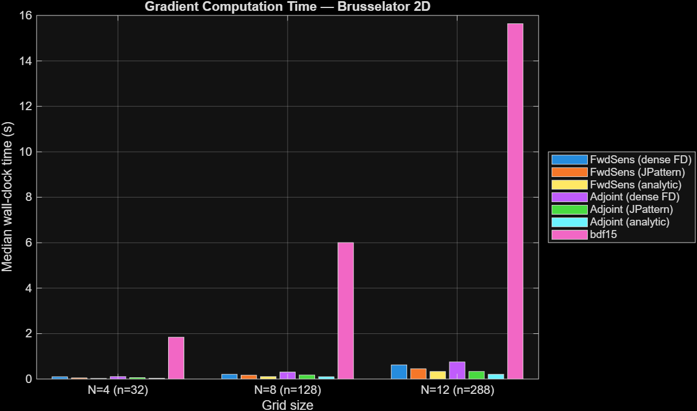
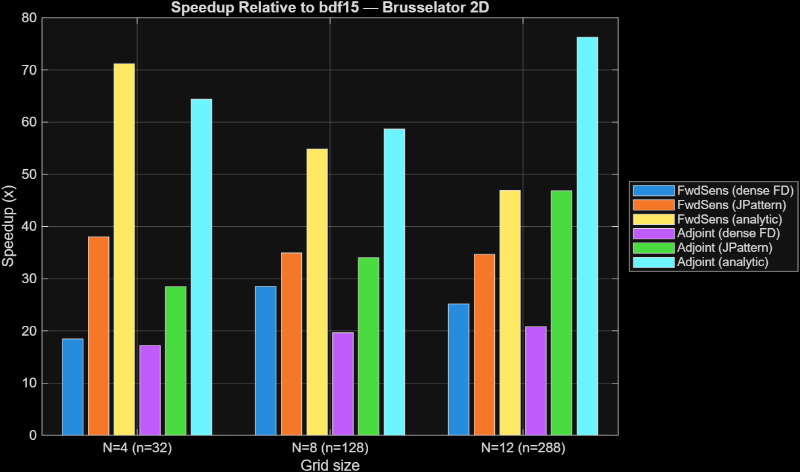

# Differentiable ODE Solvers for Stiff Systems

Differentiable implicit ODE solvers for computing gradients through stiff dynamical systems in MATLAB. Implements **continuous adjoint**, **forward sensitivity**, and **dlarray-traced** gradient methods on top of variable-order BDF/NDF schemes, with sparse Jacobian exploitation via graph coloring.

Designed for neural ODE training in MATLAB.

## Solvers

### `ode15sAdjoint` — Differentiable stiff ODE solver using the continuous adjoint method

Forward pass solves the ODE with `ode15s`. Backward pass integrates the adjoint ODE da/dt = -(df/dy)^T a backward in time and accumulates parameter gradients. Per-step cost scales with state size, not parameter count. Subclass of `deep.DifferentiableFunction`.

**Syntax**

```
solver = ode15sAdjoint(odefun,tspan)
solver = ode15sAdjoint(odefun,tspan,options)
[T,Y] = solver(Y0,theta)
```

`solver = ode15sAdjoint(odefun,tspan)` creates an `ode15s` ODE solver with adjoint-mode gradients for the specified ODE function and time interval, using default ODE options.

`solver = ode15sAdjoint(odefun,tspan,options)` also specifies ODE options, such as error tolerances, a Jacobian sparsity pattern, or an analytic Jacobian.

`[T,Y] = solver(Y0,theta)` solves the ODE from the initial conditions `Y0` with parameters `theta`. When called inside `dlfeval`, gradients of `Y` with respect to `Y0` and `theta` are computed by `dlgradient` by integrating the adjoint ODE backward in time.

**Input Arguments**

```
odefun  - Function to solve
          function handle, f = odefun(t,y,theta)
tspan   - Interval of integration
          numeric vector [t0 tf]
options - Solver options
          [] (default) | structure created with odeset
Y0      - Initial conditions
          dlarray column vector (n-by-1)
theta   - Parameters of ODE function
          dlarray column vector (m-by-1)
```

Create `options` with [`odeset`](https://www.mathworks.com/help/matlab/ref/odeset.html). All fields are passed to `ode15s` for the forward solve. The backward adjoint solve uses `RelTol`, `AbsTol`, and the Jacobian fields described in [Jacobian Options](#jacobian-options).

**Output Arguments**

```
T - Time points (numTimesteps-by-1)
Y - Solution (numTimesteps-by-n)
```

**Example**

```matlab
N = 8;
[u0, v0] = brusselatorInitialCondition(N);
x0 = dlarray([u0(:); v0(:)]);
xd = linspace(0, 1, N);
theta = dlarray([3.4; 1; 10; xd(:)]);

options = odeset(RelTol=1e-4, AbsTol=1e-6);
options.JPattern = brusselatorJPattern(N);
solver = ode15sAdjoint(@brusselatorSystem, [0 1], options);

[loss, gx0, gtheta] = dlfeval(@myLoss, solver, x0, theta);

function [loss, gx0, gtheta] = myLoss(solver, x0, theta)
    [~, yout] = solver(x0, theta);
    loss = sum(yout(end, :));
    [gx0, gtheta] = dlgradient(loss, x0, theta);
end
```

---

### `ode15sForwardSensitivity` — Differentiable stiff ODE solver using forward sensitivity analysis

Forward pass solves the ODE with `bdf15sForwardSensitivity` and propagates the sensitivity matrices dY/dY0 and dY/dtheta alongside the state. Backward pass is a single matrix multiply, with no backward ODE solve. Gradients are exact for the discrete solution. Subclass of `deep.DifferentiableFunction`.

**Syntax**

```
solver = ode15sForwardSensitivity(odefun,tspan)
solver = ode15sForwardSensitivity(odefun,tspan,options)
[T,Y] = solver(Y0,theta)
```

`solver = ode15sForwardSensitivity(odefun,tspan)` creates a BDF/NDF ODE solver with forward-sensitivity gradients for the specified ODE function and time interval, using default ODE options.

`solver = ode15sForwardSensitivity(odefun,tspan,options)` also specifies ODE options, such as error tolerances, step size controls, maximum BDF order, a Jacobian sparsity pattern, or an analytic Jacobian.

`[T,Y] = solver(Y0,theta)` solves the ODE from the initial conditions `Y0` with parameters `theta`, propagating the state sensitivities alongside the solution. When called inside `dlfeval`, gradients of the final-time solution with respect to `Y0` and `theta` are computed by `dlgradient` from the stored sensitivity matrices.

**Input Arguments**

```
odefun  - Function to solve
          function handle, f = odefun(t,y,theta)
tspan   - Interval of integration
          numeric vector [t0 tf]
options - Solver options
          [] (default) | structure created with odeset
Y0      - Initial conditions
          dlarray column vector (n-by-1)
theta   - Parameters of ODE function
          dlarray column vector (m-by-1)
```

Create `options` with [`odeset`](https://www.mathworks.com/help/matlab/ref/odeset.html). Supported fields are `RelTol`, `AbsTol`, `MaxStep`, `InitialStep`, `MaxOrder`, `BDF`, `JPattern`, and `Jacobian` (see [Jacobian Options](#jacobian-options)). Other fields are ignored.

**Output Arguments**

```
T - Time points (numTimesteps-by-1)
Y - Solution (numTimesteps-by-n)
```

Gradients flow only through the final row of `Y`.

**Example**

```matlab
options = odeset(RelTol=1e-4, AbsTol=1e-6);
options.JPattern = brusselatorJPattern(N);
solver = ode15sForwardSensitivity(@brusselatorSystem, [0 1], options);

[loss, gx0, gtheta] = dlfeval(@myLoss, solver, x0, theta);
```

---

### `bdf15sForwardSensitivity` — BDF solver with forward sensitivity propagation

Variable-order (1–5) BDF/NDF solver for y' = f(t,y,theta) that propagates the sensitivity matrices dy/dy0 and dy/dtheta in the same pass. Supports dense finite-difference, sparse finite-difference (`JPattern`), and analytic Jacobians. Used internally by `ode15sForwardSensitivity`. Operates on numeric arrays, not `dlarray`.

**Syntax**

```
[T,Y,Sy0,Stheta] = bdf15sForwardSensitivity(odefun,tspan,Y0,theta)
[T,Y,Sy0,Stheta] = bdf15sForwardSensitivity(odefun,tspan,Y0,theta,options)
```

`[T,Y,Sy0,Stheta] = bdf15sForwardSensitivity(odefun,tspan,Y0,theta)` solves the ODE y' = f(t,y,theta) over the specified time interval from the initial conditions `Y0` with parameters `theta`, using default ODE options. It returns the solution trajectory and the final-time sensitivities of the solution with respect to the initial conditions and parameters.

`[T,Y,Sy0,Stheta] = bdf15sForwardSensitivity(odefun,tspan,Y0,theta,options)` also specifies ODE options, such as error tolerances, step size controls, maximum BDF order, a Jacobian sparsity pattern, or an analytic Jacobian.

**Input Arguments**

```
odefun  - Function to solve
          function handle, f = odefun(t,y,theta)
tspan   - Interval of integration
          numeric vector [t0 tf]
Y0      - Initial conditions
          numeric column vector (n-by-1)
theta   - Parameters of ODE function
          numeric column vector (m-by-1) | []
options - Solver options
          [] (default) | structure created with odeset
```

Create `options` with [`odeset`](https://www.mathworks.com/help/matlab/ref/odeset.html). Supported fields are `RelTol`, `AbsTol`, `MaxStep`, `InitialStep`, `MaxOrder`, `BDF`, `JPattern`, and `Jacobian` (see [Jacobian Options](#jacobian-options)). Other fields are ignored.

**Output Arguments**

```
T      - Time points (numTimesteps-by-1)
Y      - Solution (numTimesteps-by-n)
Sy0    - Final-time sensitivity dy(tf)/dy0 (n-by-n)
Stheta - Final-time sensitivity dy(tf)/dtheta (n-by-m)
```

**Example**

```matlab
y0 = [u0(:); v0(:)];
theta = [3.4; 1; 10; xd(:)];

options = odeset(RelTol=1e-4, AbsTol=1e-6);
options.JPattern = brusselatorJPattern(N);

[tout, yout, Sy0, Stheta] = bdf15sForwardSensitivity(@brusselatorSystem, [0 1], y0, theta, options);
```

---

### `bdf15` — dlarray-compatible BDF solver

Variable-order (1–5) BDF/NDF solver for y' = f(t,y) whose Newton iterations are traced through `dlarray`, so gradients come from standard reverse-mode AD. Slower than `ode15sAdjoint` and `ode15sForwardSensitivity` because the whole solver graph is stored and backpropagated. Included as a benchmarking baseline.

**Syntax**

```
[T,Y] = bdf15(odefun,tspan,Y0)
[T,Y] = bdf15(odefun,tspan,Y0,options)
```

`[T,Y] = bdf15(odefun,tspan,Y0)` solves the ODE y' = f(t,y) over the specified time interval from the `dlarray` initial conditions `Y0`, using default ODE options. Every operation of the solve is traced, so when called inside `dlfeval`, gradients of `Y` with respect to `Y0` and any parameters captured in `odefun` are computed by `dlgradient` using reverse-mode automatic differentiation.

`[T,Y] = bdf15(odefun,tspan,Y0,options)` also specifies ODE options, such as error tolerances, step size controls, maximum BDF order, or the Jacobian.

**Input Arguments**

```
odefun  - Function to solve
          function handle, f = odefun(t,y)
          Capture parameters in a closure, e.g. @(t,y) f(t,y,theta).
tspan   - Interval of integration
          numeric vector [t0 tf]
Y0      - Initial conditions
          dlarray column vector (n-by-1)
options - Solver options
          [] (default) | structure created with odeset
```

Create `options` with [`odeset`](https://www.mathworks.com/help/matlab/ref/odeset.html). Supported fields are `RelTol`, `AbsTol`, `MaxStep`, `InitialStep`, `MaxOrder`, `BDF`, and `Jacobian` (see [Jacobian Options](#jacobian-options)). Other fields, including `JPattern`, are ignored.

**Output Arguments**

```
T - Time points (numTimesteps-by-1)
Y - Solution (numTimesteps-by-n), traced dlarray
```

**Example**

```matlab
x0 = dlarray([u0(:); v0(:)]);
theta = dlarray([3.4; 1; 10; xd(:)]);
options = odeset(RelTol=1e-4, AbsTol=1e-6);

[loss, gx0, gtheta] = dlfeval(@myLossDl, x0, theta, [0 1], options);

function [loss, gx0, gtheta] = myLossDl(x0, theta, tspan, options)
    odefun = @(t, y) brusselatorSystem(t, y, theta);
    [~, yout] = bdf15(odefun, tspan, x0, options);
    loss = sum(yout(end, :));
    [gx0, gtheta] = dlgradient(loss, x0, theta);
end
```

## Jacobian Options

The solvers compute the Jacobian df/dy (and, for the sensitivity and adjoint solvers, df/dtheta) in one of three ways. You choose one by setting fields of the `odeset` options structure:

| Mode | How to select | Cost per Jacobian | Supported by |
|------|---------------|-------------------|--------------|
| Dense finite differences | Default (no `JPattern` or `Jacobian`) | n function evaluations | All solvers |
| Sparse finite differences | `options.JPattern = S` | nColors function evaluations | `ode15sAdjoint`, `ode15sForwardSensitivity`, `bdf15sForwardSensitivity` |
| Analytic | `options.Jacobian = @jacfcn` | One call to `jacfcn` | All solvers |

- **Sparse finite differences**: `S` is the n-by-n sparsity pattern of df/dy. Greedy graph coloring groups structurally independent columns so they can be perturbed together, reducing the cost from n to nColors evaluations. `JPattern` is ignored when `Jacobian` is set.
- **Analytic**: `jacfcn` takes the same arguments as `odefun`. For `ode15sAdjoint`, `ode15sForwardSensitivity`, and `bdf15sForwardSensitivity`, it must return both derivatives, `[dfdy,dfdtheta] = jacfcn(t,y,theta)`. Note that this differs from `ode15s`, whose Jacobian returns only df/dy. For `bdf15`, `Jacobian` follows the `ode15s` convention: a matrix or `dfdy = jacfcn(t,y)`.

For example, to use the analytic Brusselator Jacobian:

```matlab
options = odeset(RelTol=1e-4, AbsTol=1e-6, Jacobian=@brusselatorJacobian);
solver = ode15sAdjoint(@brusselatorSystem, [0 1], options);
```

## Brusselator 2D Test Problem

The benchmark problem is the Brusselator, a model autocatalytic reaction-diffusion system with two chemical species _u_ and _v_ on the unit square, discretized on an N x N spatial grid (total state dimension 2N^2).

### Files

| File | Description |
|------|-------------|
| `brusselatorSystem.m` | ODE right-hand side for the 2D Brusselator with periodic boundary conditions and localized external forcing. |
| `brusselatorJacobian.m` | Hand-derived sparse Jacobian (df/dy and df/dtheta) for the Brusselator system. |
| `brusselatorJPattern.m` | Structural sparsity pattern of the Jacobian for sparse finite-difference column grouping. |
| `brusselatorInitialCondition.m` | Initial conditions: non-uniform parabolic profiles for both chemical species. |
| `performanceComparisonForBrusselatorSystem.m` | Benchmark script comparing all solver/Jacobian combinations across grid sizes N = 4, 8, 12. |

### Governing equations

```
du/dt = alpha * nabla^2(u) + B + u^2 * v - (A + 1) * u + f(x, y, t)
dv/dt = alpha * nabla^2(v) + A * u - u^2 * v
```

where:

| Symbol | Meaning | Benchmark value |
|--------|---------|-----------------|
| A      | Reaction rate constant | 3.4 |
| B      | Feed concentration | 1 |
| alpha  | Diffusion coefficient | 10 |

### Spatial discretization

The Laplacian is approximated with a standard 5-point stencil (centered finite differences) on a uniform grid with spacing dx = 1/(N-1) and **periodic boundary conditions** (wrapped indices).

### External forcing

A localized perturbation drives the system away from equilibrium:

```
f(x, y, t) = 5    if (x - 0.3)^2 + (y - 0.6)^2 <= 0.01  and  t >= 1.1
              0    otherwise
```

### Initial conditions

```
u(x, y, 0) = 22 * (y * (1 - y))^(3/2)
v(x, y, 0) = 27 * (x * (1 - x))^(3/2)
```

### Parameters vector

The solvers receive a single parameter vector `theta = [A; B; alpha; xd(:)]`, where `xd` is the 1D grid coordinate vector (length N). The Brusselator test problem has `N + 3` parameters in total.

## Benchmark Results

Output of `performanceComparisonForBrusselatorSystem.m` comparing all methods on the 2D Brusselator reaction-diffusion system at three grid resolutions. Times are median wall-clock over 3 runs (1 warmup).

```
--- N=4 (state dim = 32) ---
JPattern: nnz=192, nColors=8 (vs n=32 dense FD columns)
Method                                 Gradient
ode15sForwardSensitivity (dense FD)     0.0997s
ode15sForwardSensitivity (JPattern)     0.0484s
ode15sForwardSensitivity (analytic)     0.0258s
ode15sAdjoint (dense FD)                0.1069s
ode15sAdjoint (JPattern)                0.0646s
ode15sAdjoint (analytic)                0.0286s
bdf15                                   1.8400s
```

```
--- N=8 (state dim = 128) ---
JPattern: nnz=768, nColors=11 (vs n=128 dense FD columns)
Method                                 Gradient
ode15sForwardSensitivity (dense FD)     0.2104s
ode15sForwardSensitivity (JPattern)     0.1719s
ode15sForwardSensitivity (analytic)     0.1094s
ode15sAdjoint (dense FD)                0.3056s
ode15sAdjoint (JPattern)                0.1764s
ode15sAdjoint (analytic)                0.1023s
bdf15                                   6.0035s
```

```
--- N=12 (state dim = 288) ---
JPattern: nnz=1728, nColors=10 (vs n=288 dense FD columns)
Method                                 Gradient
ode15sForwardSensitivity (dense FD)     0.6216s
ode15sForwardSensitivity (JPattern)     0.4511s
ode15sForwardSensitivity (analytic)     0.3333s
ode15sAdjoint (dense FD)                0.7525s
ode15sAdjoint (JPattern)                0.3338s
ode15sAdjoint (analytic)                0.2050s
bdf15                                  15.6363s
```





## Requirements

- MATLAB R2024a or later
- Deep Learning Toolbox (for `dlarray`, `dlfeval`, `deep.DifferentiableFunction`)

