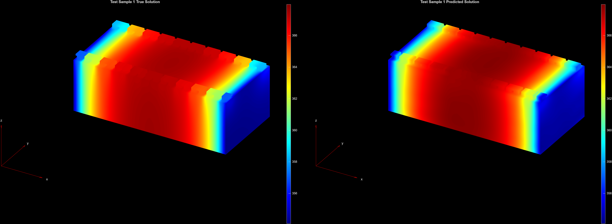
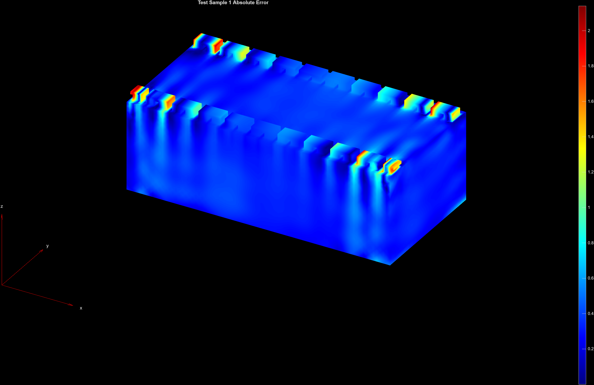

# Tensorized Fourier Neural Operator for 3-D Battery Heat Analysis

This example builds off of the [3-D Battery Module Cooling Analysis Using Fourier Neural Operator](https://www.mathworks.com/help/pde/ug/3-d-battery-module-cooling-analysis-using-fourier-neural-operator.html) example to apply a Tensorized Fourier Neural Operator (TFNO) [1, 2] to heat analysis of a 3D battery module. The TFNO compresses the standard Fourier Neural Operator using tensorization, achieving 14.3x parameter reduction while maintaining accuracy.

## Setup

Run the example by running [`tensorizedFourierNeuralOperatorFor3DBatteryHeatAnalysis.m`](./tensorizedFourierNeuralOperatorFor3DBatteryHeatAnalysis.m).

## Requirements

Requires:
- [MATLAB](https://www.mathworks.com/products/matlab.html) (R2026a or newer)
- [Deep Learning Toolbox&trade;](https://www.mathworks.com/products/deep-learning.html)
- [Partial Differential Equation Toolbox&trade;](https://mathworks.com/products/pde.html)
- [Parallel Computing Toolbox&trade;](https://mathworks.com/products/parallel-computing.html) (for training on a GPU)

## References
[1] Li, Zongyi, et al. "Fourier Neural Operator for Parametric Partial Differential Equations." 
In International Conference on Learning Representations (2021). https://arxiv.org/pdf/2010.08895

[2] Kossaifi, Jean, et al. Kossaifi, Jean, et al. "Multi-Grid Tensorized Fourier Neural Operator for High-Resolution PDEs." 
Transactions on Machine Learning Research (2024). https://arxiv.org/pdf/2310.00120

## Example Overview

This example applies a 3D Tensorized Fourier Neural Operator (TFNO) to thermal analysis of a battery module composed of 20 cells. Given initial conditions (ambient temperature, convection, heat generation) at T=0, the TFNO predicts temperature distribution at T=10 minutes.

### TFNO Modifications

The TFNO includes two key modifications from the standard FNO:
1. **New Architecture**: Adds layer normalization, MLPs, and linear skip connections
2. **Tensorized spectral convolution**: Low-rank approximation of weight tensors in spectral convolution layers

### Key Hyperparameters

- **Input channels**: 6 (ambient temperature, convection, heat generation) and (x, y, z) spatial locations
- **Output channels**: 1 (temperature)
- **Number of modes**: 4 (retained Fourier modes per dimension)
- **Hidden channels**: 64
- **FNO blocks**: 4
- **Compression rank**: 0.05 (5% of original parameters in spectral convolution layers)
- **Grid resolution**: 32×32×32

### Highlights

- **Inference speed**: 64ms per sample (batch size 1) on NVIDIA RTX 2080 Ti GPU and 222ms on Intel Xeon CPU (144x faster than FEM solver, comparable with the architecture from the prior [FNO example](https://www.mathworks.com/help/pde/ug/3-d-battery-module-cooling-analysis-using-fourier-neural-operator.html))
    - The speedup may be more pronounced on larger problem domains, higher dimensional problems, and/or when running inference on memory-constrained devices
- **Error**: 0.04 L2 test error and 3.94e-5 relative H1 test error
    - L2 error is comparable to the FNO, while relative H1 error is better
- **Training time**: 6.66 hours for 1000 epochs
- **Parameter reduction**: From 3,263,809 in the FNO to 227,521 parameters in the TFNO, a 14.35x reduction
- **Memory footprint**: 2.17MB for TFNO vs 23.76MB for FNO

### Considerations
The example here is one instance of a TFNO applied to battery thermal analysis. The TFNO may be further optimized with negligible accuracy loss by:
- Experimenting with higher compression ratios to achieve greater parameter reduction
- Reducing the number of hidden channel dimensions
- Reducing the number of FNO blocks

---
Copyright 2026 The MathWorks, Inc.
